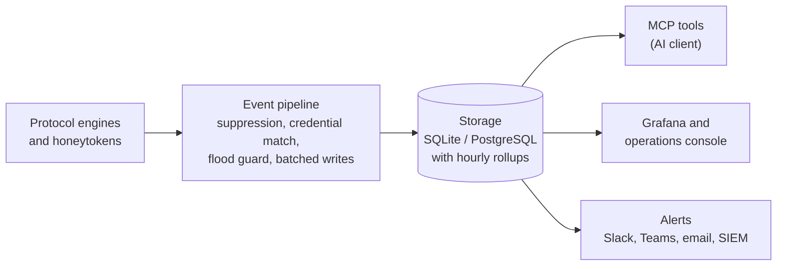
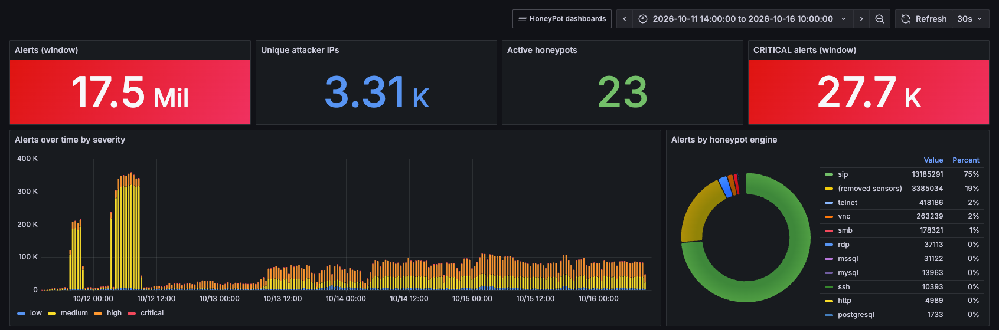

# HoneyPot MCP

[](https://github.com/tohudgins/HoneyPot-MCP/actions/workflows/ci.yml)
[](LICENSE)
[](pyproject.toml)

**An MCP server that deploys honeypots and honeytokens, and turns what attackers do into telemetry you analyse by talking to an AI client.**

```
> Deploy an SSH honeypot on port 2222 and an HTTP one on 8080.
> Anything critical in the last hour?
> Reconstruct what <ip> did across all my honeypots.
> Export an iptables blocklist for anyone with 10+ hits.
```

## What it is

HoneyPot MCP is a single server that runs decoy services and decoy credentials, records everything that touches them, and exposes the result through the [Model Context Protocol](https://modelcontextprotocol.io). Claude Desktop, Claude Code or any other MCP client becomes the console: you deploy sensors, triage alerts, reconstruct an attacker's session and export blocklists in plain language. The engines capture the artefacts (credentials, commands, dropped files, ransom notes, captured password hashes) and the tools answer questions about them.

## What you get

| | |
|---|---|
| **25 protocol engines** | Remote access (SSH, Telnet, RDP, VNC), databases (MySQL, PostgreSQL, MSSQL, MongoDB, Redis, Elasticsearch, Memcached), web and APIs (HTTP/S, Docker API, Kubernetes API), mail (SMTP, IMAP, POP3), file sharing (SMB, FTP, NFS, rsync), VoIP and directory (SIP, LDAP, SNMP, DNS), tested against real clients and scanners |
| **Honeytokens and canary files** | Cloud keys, credential pairs, canary URLs, document trackers and more; a planted credential used on any honeypot escalates straight to CRITICAL |
| **83 MCP tools in three roles** | Viewer, operator and admin, with live-provisioned per-person API keys and an audit log of every control-plane action |
| **Analysis** | MITRE ATT&CK mapping (with a tool that measures its accuracy against blind labels), attacker profiles and risk scores, cross-honeypot timelines, campaign correlation, what attackers did (credentials, commands, dropped files, SSH clients, SIP dialling), who used the bait, packet captures replayed through Suricata or Zeek, YARA scanning of captured files, reports and STIX export, all as tools |
| **Dashboards** | Five provisioned Grafana dashboards (started by one tool call, on loopback only) and a built-in read-only operations console |
| **Alerts** | Slack, Teams, email and SIEM delivery (Splunk, Elastic, CEF, syslog, Loki, Datadog) |
| **Threat intelligence** | Optional VirusTotal, AbuseIPDB, GeoIP, GreyNoise, abuse.ch, OTX and Shodan InternetDB enrichment |

Per-tool and per-engine detail is in [docs/REFERENCE.md](docs/REFERENCE.md).

## How it works



Engines never write to the database directly: every event passes one ingestion path that applies suppression rules, matches planted credentials and caps floods before a single flusher writes it in batches. Statistics are served from hourly rollups rather than the raw alert table, so the cost of an answer does not grow with the size of the database. Tool responses are shaped for an AI context window: list tools return digests, one tool expands a single alert, and bulk output goes to disk. [CLAUDE.md](CLAUDE.md) documents the pipeline and the plugin patterns.

## Applied on a real VPS

The project was run on a public-IP VPS for about five days (116 hours). It stored about 17.7 million events from more than 3,300 source addresses across the 23 engine types deployed (SMTP and DNS were deliberately left off a public address). The traffic was what the internet sends to open services: brute-forcing, scanning, exploit attempts, and a planted credential being replayed against another sensor from outside the host. Every deployed engine was also attacked with real clients from outside, and the headline figures were cross-checked with an independent set of raw-SQL queries. The full write-up, with method and limits, is in [docs/RESULTS.md](docs/RESULTS.md).

<table>
<tr>
<td width="33%"><a href="docs/screenshots/real-run/overview.png"></a><br><sub>Grafana overview: volume, sources and the per-engine split.</sub></td>
<td width="33%"><a href="docs/screenshots/real-run/threat-map.png"></a><br><sub>Threat map of attacker origins.</sub></td>
<td width="33%"><a href="docs/screenshots/real-run/mitre-coverage.png"></a><br><sub>ATT&amp;CK tactic coverage from the same database.</sub></td>
</tr>
</table>

## Get started

A two-minute demo stack needs Docker and one variable (the Grafana admin password, which has no default), no API keys and no MCP client:

```bash
git clone https://github.com/tohudgins/HoneyPot-MCP.git
cd HoneyPot-MCP/docker
export GRAFANA_ADMIN_PASSWORD="$(openssl rand -hex 16)"   # required; echo it to log in
docker compose up -d --build

# Seed ~5,000 synthetic attack events across the last 24h
docker compose exec honeypot-mcp python scripts/seed_demo_data.py

open http://localhost:8090   # operations console
open http://localhost:3000   # Grafana: user admin, the password above
```

This starts the server, a live Cowrie SSH honeypot on `:2222`, an HTTP honeypot on `:8080`, Prometheus and the Grafana dashboards. SSH into `localhost:2222` with any password and your session appears in the console within seconds.

- Install, run modes, MCP client setup, access roles and integrations: [docs/REFERENCE.md](docs/REFERENCE.md)
- Deploying on a VPS to catch real traffic: [docs/DEPLOY.md](docs/DEPLOY.md)
- Hardening the host first: [docs/HARDENING.md](docs/HARDENING.md)

## Documentation

| Document | What it covers |
|---|---|
| [docs/README.md](docs/README.md) | Index of the documentation |
| [docs/REFERENCE.md](docs/REFERENCE.md) | Capabilities, install, run modes, every MCP tool, SIEM delivery, packet capture |
| [docs/DEPLOY.md](docs/DEPLOY.md) | VPS deployment, go-live checklist, backups, offline analysis |
| [docs/HARDENING.md](docs/HARDENING.md) | Host hardening: firewall, Docker guard, sandboxed services |
| [docs/RESULTS.md](docs/RESULTS.md) | What the 116-hour run captured and found |
| [docs/FIELD_TEST.md](docs/FIELD_TEST.md) | The scripts that attack every engine and check the answers |
| [KNOWN_LIMITATIONS.md](KNOWN_LIMITATIONS.md) | What works, what does not, and why |
| [CHANGELOG.md](CHANGELOG.md) | What changed in each release |
| [CONTRIBUTING.md](CONTRIBUTING.md) | Development setup and the non-obvious rules |
| [SECURITY.md](SECURITY.md) | Private vulnerability reporting |

## Responsible use

Deploy honeypots only on infrastructure you own and are allowed to expose. A honeypot deliberately attracts hostile traffic and stores the malware and credentials it is sent, so treat the host as untrusted and follow [docs/HARDENING.md](docs/HARDENING.md) before putting one on a public address. The software is provided as is, without warranty.

Not verified: GreyNoise enrichment and the pfSense, Cloudflare and AWS WAF push tools were not run against real services.

## License

[MIT](LICENSE)
